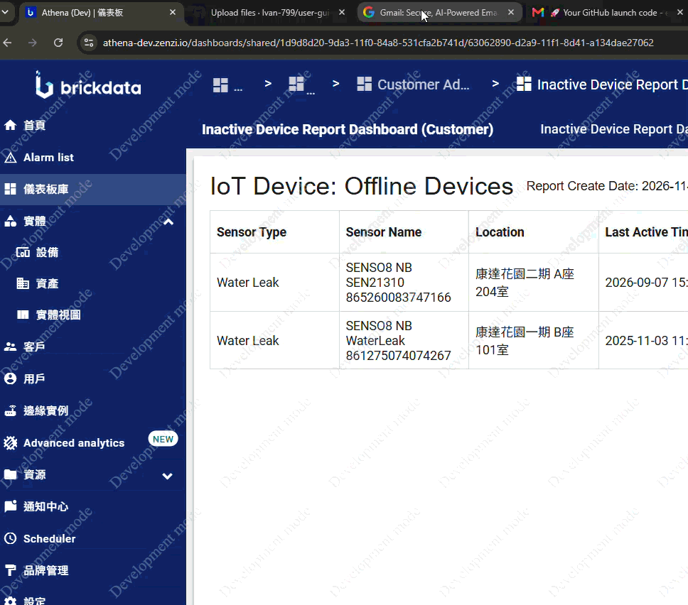

# 手機應用程式指南

## 主要功能
手機應用程式為不同的用戶角色提供服務：
- **報修者**：新增工作單、查看已報告工作單，以及更新已報告工作單（於未開始狀態時）。
- **前線人員**：查看獲指派的工作單並更新進度。
- **主管**：查看獲指派的工作單、審核並批准已提交的工作單。
- **巡邏員**：執行巡邏，並在需要時報告工作單。

## 工作區（首頁）
工作區提供行動操作的中央儀表板：
- **狀態與同步**：查看設備狀態（在線中/離線中）、通知和手動同步按鈕。
- **導航**：切換場地、進入個人檔案頁面以及新增工作單。
- **儀表板**：
    - 當前日期和任務摘要。
    - 今日預定巡邏的總數。
    - 未完成的指派工作單和已報告工作單的總數。
    - 最後更新時間。
- **任務詳情**：
    - 今日預定路線列表（包含開始時間和狀態）。
    - 按優先度分類的未完成工作單。

## 巡邏管理
巡邏員可以在手機應用程式上執行多種操作：

### 記錄到達巡邏點
1. 進入「工作區」。
2. 選擇預定路線區塊以查看今日巡邏計劃（00:00 - 23:59）。
3. 點擊一條預定路線。
4. 使用以下其中一種方法記錄到達：
    - **NFC**：將設備靠近已註冊的 NFC 標籤。
    - **二維碼**：點擊掃描圖示並掃描位置的二維碼。
    - **螢幕觸控**：點擊屏幕上的特定位置卡片。
5. 點擊「開始」開始巡邏。
6. 按順序對後續位置重複操作。

**巡邏點狀態標示**：
- **灰色**：未開始。
- **綠色**：已到達。
- **紫色**：已跳過。

### 在巡邏點加入照片
1. 在巡邏進行中，點擊任何巡邏點的「加入照片」。
2. 拍攝新照片或從設備相簿中選擇。
3. 確認清晰度，必要時添加繪圖或描述。
4. 提交上傳。  

**備註：**
- 只要巡邏路線已開始（即已記錄至少一個巡邏點）且狀態為「進行中」，即可在任何時間為任何巡邏點上傳照片  
- 請務必在結束巡邏前完成所有照片的拍攝與上傳（即在記錄最後一個巡邏點前，先上傳照片再記錄到達）  

### 跳過巡邏點或路線
- **跳過巡邏點**：點擊巡邏點上的跳過按鈕，選擇原因並添加備註。
- **跳過路線**：點擊右上角的「...」選單並選擇「全部跳過」。
- **跳過剩餘巡邏點**：點擊右上角的「...」選單並選擇「完成巡邏」以跳過當前路線中任何未完成的點。

### 填寫清單
1. 在到達巡邏點之前，點擊該點的「清單」按鈕。
2. 填寫並提交必填項目。
3. **注意**：在完成所有必填清單項目之前，該位置無法標記為「已到達」。

## 工作單管理
用戶可以直接從手機應用程式管理工作單。

### 新增工作單
1. 從「工作區」點擊「新增工作單」或使用工作單列表中的「+」圖示。
2. 填寫必填欄位：位置、事件項目和用戶組別。
3. 提供可選詳情：描述、事件聯絡人和事件聯絡電話。
4. 附加照片或影片以記錄問題。
5. 提交工作單。

### 查看工作單
1. 從「工作區」進入工作單列表（待處理工作單或已報告工作單）。
2. 按優先度或狀態篩選工作單。
3. 點擊工作單以查看詳情：
    - 工作單參考編號、建立時間、狀態和優先度。
    - 位置和事件類別/項目。
    - 指派的用戶組別、描述、事件聯絡人和事件聯絡電話。
    - 媒體附件（用於報告和完成階段的照片/影片）。

### 修改工作單
- **更新狀態**：使用「開始工作」將狀態從「新建」改為「進行中」，使用「完成」改為「已完成」。
- **注意**：狀態更新必須遵循 新建 -> 進行中 -> 已完成 的順序。不允許跳過或退回。
- **編輯詳情**：點擊「新建」或「進行中」工作單上的「修改」圖示，以更新位置、描述或附件等詳情。

## 個人資料頁面
個人資料頁面包含：
- 帳戶詳情（姓名、職位、用戶名稱、電郵、聯絡電話）。
- 應用程式設置（語言切換：英文、繁體中文、簡體中文）。
- 使用指南和許可證等應用程式版本資訊。  
- 登出按鈕。  

## 通知  
流動裝置通知將透過以下兩種方式呈現：
1. 推送通知
   當發生以下情境時，系統會發出即時推播提示：
   1.1.　有新的工作單
   1.2.　工作單狀態有更新
   1.3.　有預定巡邏路線將於 15 分鐘內開始

2. 應用程式內通知列表  
   2.1.　有新的工作單
   2.2.　工作單狀態有更新
   2.3.　有預定巡邏路線將於 15 分鐘內開始
   2.4.　手機應用程式錯誤訊息  

**備註：**
- 通知項目 1.1 至 2.3 僅指派人員才會收到。  
- 通知數據直接記錄並儲存於單一裝置。這意味著在「裝置 A」上收到並顯示的通知，不會同步顯示在「裝置 B」上（即使兩部裝置登入同一個帳戶）。  
- 列表中的通知可透過向左滑動進行單獨刪除。  

### 操作通知  
1. 點擊工作區右上角的通知圖示，進入應用程式內的通知列表頁面。
2. 點擊通知列表右上角的 「標記為已讀 」 圖示，清除列表內所有未讀標記（即通知右側的圓點提示）。
3. 點擊任意一條工作單通知，直接跳轉並開啟對應的工作單詳細記錄。
4. 在該條通知上向左滑動刪除該筆通知，將其從列表中移除。

## 儀表板  

租戶管理員登入系統後，將會直接進入預設的跨場地儀表板。該儀表板匯總了管理員有權訪問的所有場地數據，主要由以下三個核心數據區塊組成：
- 未完成工作單
- 前 5 未完成工作單 按優先度統計
- 工作單完成摘要

### 未完成工作單
- 自動列出目前用戶有權訪問的場地中，未完成工單數量最多 的 5 個場地。
- 按每個場地顯示狀態為 「未開始」、「需重做」、「處理中」  與 「已提交」 的工作單數量。
- 點擊區塊底部的 「查看全部」 按鈕，可查閱該帳戶有權訪問的所有場地列表。
- 點擊特定場地，可進一步查看該場地內按狀態分類的工作單；點擊具體工作單則可開啟並檢視其詳細內容。

**備註：**
由儀表板開啟的工作單只供檢視。

### 前 5 未完成工作單 按優先度統計
- 以直觀的長條圖呈現未完成工作單累積最多的前 5 個場地。
- 每條長條代表一個場地，並依據工作單的優先度進行色彩分段，藉此展示各等級工作單的數量與所佔比例。
- 長按某條長條，系統將彈出提示，顯示該場地內各個優先度的工作單數量。

### 工作單完成摘要
- 按處理時長對已完成的工作單進行分類統計，分別顯示在「7 天內」、「8-14 天」、「15-30 天」以及「超過 30 天」內完成的工作單數，並統計整體的完成數量。

### 其他操作
- 點擊儀表板右上角的 「重新整理 」 按鈕，即可即時更新頁面上顯示的所有數據。
- 在儀表板頁面上點擊 「首頁」 按鈕，然後從列表中選擇目標場地，即可進入該場地專屬的工作區。
- 在工作區頁面中，點擊右上角的 「儀表板」 按鈕，即可隨時返回此儀表板。
